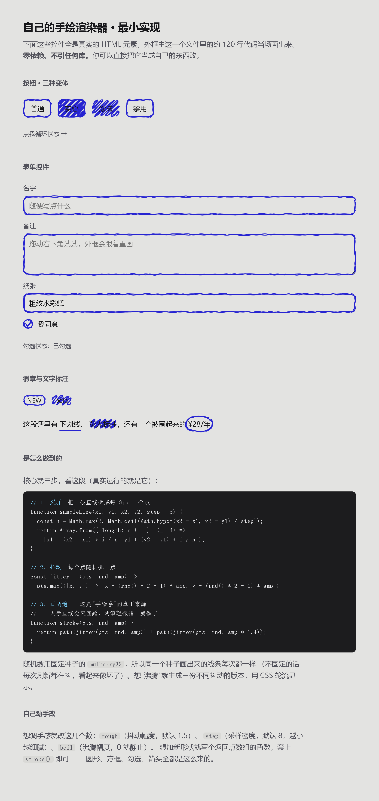

# handdrawn-ui

用手绘线条装饰真实的 HTML 控件。零依赖，单文件，一个 `index.html` 就是全部。

**[→ 打开演示](index.html)**（下载后双击即可，不需要构建、不需要服务器）



---

## 这是什么

一个约 120 行的渲染器，把普通的 `<button>`、`<input>`、`<select>` 的边框换成手绘线条。

关键在于：**控件本身还是真的**。键盘能聚焦、表单能提交、`disabled` 照样生效——只是看起来像随手画的。

```
真实 HTML 控件  +  SVG 手绘外框  =  手绘 UI
      ↑                  ↑
  行为、无障碍        纯视觉装饰
```

---

## 效果怎么来的

核心只有三步，全部代码在 `index.html` 的 `<script>` 里，没有压缩、没有依赖。

### 1. 采样

把一条直线拆成每 8px 一个点：

```js
function sampleLine(x1, y1, x2, y2, step = 8) {
  const n = Math.max(2, Math.ceil(Math.hypot(x2 - x1, y2 - y1) / step));
  return Array.from({ length: n + 1 }, (_, i) =>
    [x1 + (x2 - x1) * i / n, y1 + (y2 - y1) * i / n]);
}
```

### 2. 抖动

每个点随机挪一点，直线就有了手的犹豫：

```js
const jitter = (pts, rnd, amp) =>
  pts.map(([x, y]) => [x + (rnd() * 2 - 1) * amp, y + (rnd() * 2 - 1) * amp]);
```

### 3. 画两遍 ← 手绘感的真正来源

人手画线会来回蹭，两笔轻微错开，就像手画的了：

```js
function stroke(pts, rnd, amp) {
  return toPath(jitter(pts, rnd, amp)) +
         toPath(jitter(pts, rnd, amp * 1.4));   // 第二遍错得更开
}
```

**随机数用固定种子**（`mulberry32`）。不固定的话每次刷新线条都在变，看起来像坏了——固定种子才能让同一次访问里线条是稳定的。

### 沸腾效果

生成三份不同抖动的版本，用 CSS 每 1200ms 轮换透明度，线条就会轻轻"呼吸"：

```css
@property --f { syntax: "<integer>"; inherits: true; initial-value: 0; }
.sk > svg { animation: boil 1200ms step-end infinite; }
@keyframes boil { 0% { --f: 0 } 33.33% { --f: 1 } 66.67% { --f: 2 } }
/* 每个 path 只在自己那一帧可见 */
.sk > svg path[data-f="0"] { opacity: calc(1 - abs(var(--f) - 0)); }
```

已经处理了 `prefers-reduced-motion`：系统开了"减少动态效果"就自动静止。

---

## 用法

### 方式一：直接改这个仓库的文件（最快）

下载 `index.html`，双击就能看效果。要改成你自己的页面，就在同一个文件里改 HTML 和 `<script>` 里"开始使用"那一段——**代码已经全部内联，不需要构建，也不需要服务器**。

### 方式二：把渲染器拿进你的项目

把 `index.html` 里从 `mulberry32` 到 `mount` 那一段（约 120 行）复制进去即可。这段是自包含的，不依赖任何东西。

如果你用打包工具（Vite / webpack / Next 等），也可以直接用仓库里的 `renderer.js`——它导出了同样的函数：

```js
import { mount, shape } from "./renderer.js";

mount(document.querySelector("button"), shape.rect, { seed: 1 });
```

> ⚠️ **`renderer.js` 不能直接用 `file://` 打开。**浏览器禁止 `file://` 下的 ES module 跨文件加载（CORS 限制），所以拆成独立模块后双击打开会失效。这就是 `index.html` 选择把代码内联的原因——**要双击可用就用 `index.html`，要在打包项目里用就 import `renderer.js`**。

```html
<!-- 无论哪种方式，都必须清掉原生边框，并给宿主加一层定位样式 -->
<style>
  button, input, textarea, select {
    border: 0; background: none; appearance: none; outline: none;
    font: inherit; color: inherit;
  }
  .sk { position: relative; isolation: isolate; display: inline-block; }
  .sk > svg {
    position: absolute; inset: 0; width: 100%; height: 100%;
    overflow: visible; pointer-events: none; z-index: -1;
  }
  .sk > svg path { fill: none; stroke: var(--ink); stroke-width: 2;
                   stroke-linecap: round; stroke-linejoin: round; }
</style>

<script>
  // 按钮直接用；带 input 的控件挂在包装元素上
  mount(document.querySelector("button"), shape.rect, { seed: 1 });
  mount(document.getElementById("name-wrap"), shape.rect, { seed: 2 });
</script>
```

> **注意**：控件的原生 `border` 必须清零。手绘线负责视觉边界，两套边框叠在一起会很难看——这是最容易漏的一条。

---

## API

### `mount(host, shapeFn, options)`

把一组手绘线条挂到元素上，返回一个句柄。

| 参数 | 说明 |
|---|---|
| `host` | 宿主元素。按钮/输入框直接用；带 `input` 的控件挂在**包装元素**上 |
| `shapeFn` | 形状函数，签名 `(宽, 高) => 点数组` |
| `options.seed` | 随机种子。同种子 = 同一条线 |
| `options.amp` | 抖动幅度，默认 1.5。越大手越抖 |
| `options.close` | 路径是否闭合，默认 `true` |
| `options.fill` | 是否填充，默认 `false` |
| `options.layer` | 图层名。同一宿主挂多层时用来区分 |

返回值：`{ redraw(), reseed(seed) }`

### 内置形状

```js
shape.rect        // 圆角矩形外框
shape.pill        // 胶囊形（开关、滑块）
shape.circle      // 圆 / 椭圆
shape.check       // 勾选标记
shape.scribble    // 来回涂抹填充
shape.underline   // 文字下划线
shape.lasso       // 圈选（比文字大一圈）
```

### 可调参数

```js
const CFG = {
  rough: 1.5,   // 抖动幅度 —— 手感的主要来源
  step: 8,      // 采样密度，越小越细腻（也越费性能）
  boil: 0.6,    // 沸腾幅度，0 就完全静止
};
```

### 键盘快捷键

演示页里按 **R** 键会给整页重新随机种子——相当于换一只手画。

---

## 加自定义形状

形状函数就是"给一个宽高，返回一串点"，所以加新形状很容易：

```js
// 例：一个手绘箭头
function arrow(w, h) {
  const pts = [...sampleLine(0, h / 2, w - 12, h / 2)];   // 杆
  pts.push(...sampleLine(w - 12, h / 2, w - 20, h / 2 - 8, 4)); // 上翼
  pts.push(...sampleLine(w - 12, h / 2, w - 20, h / 2 + 8, 4)); // 下翼
  return pts;
}

mount(el, arrow, { seed: 7, close: false });
```

已经内置的采样器和点集工具：`sampleLine`、`ellipsePoints`、`roundRectPoints`、`checkPoints`、`scribblePoints`。

---

## 更多示例：50 个组件

`gallery/50-components.html` 是一个更大的展示页——**50 个手绘组件**，双击即可打开：

| 分组 | 内容 |
|---|---|
| 基础控件（14） | 按钮、勾选三件套、输入框、文本域、下拉、滑块、进度条、星级、徽章、卡片、列表、分隔线、标签页、标签片 |
| 数据可视化（12） | 折线、柱状、环形、迷你趋势线、热力图、雷达、仪表盘、瀑布、矩形树图、漏斗、散点、迷你柱 |
| 交互动效（12） | 音效板、手风琴、气泡通知、弹窗、抽屉、气泡提示、下拉菜单、步骤条、分页、分段切换、验证码、开关卡片 |
| 进阶组合（12） | 3D 轮播、字符画、跑马灯、时间轴、前后对比、引用块、文字标注、看板、空状态、新手引导、拖拽上传、参数实验台 |

其中几个值得一提的实现：**音效板**用 Web Audio 的振荡器实时合成 9 种界面音效（零音频文件）；**字符画**是真做了环面投影并把亮度映射到字符密度；**参数实验台**可以实时拖动调节笔触手感。

页面右上角能**换笔色**和**重新落笔**（整页 1595 条笔画全部重画），顶部可以**按名字筛选**组件。

> **关于这个页面的依赖**：它使用了 [drawably](https://github.com/danielwh2/drawably)（MIT，Copyright © Daniel Belyi）来绘制基础控件的外框，代码已内联进单文件，并在文件头部保留了完整的出处与许可声明。其余 36 个组件为自行实现，复用了 drawably 导出的 rough 渲染器与随机数模块。**如果你想要一个完全无第三方代码的版本，用 `index.html`。**

---

## 几个坑

做的时候踩过的，写下来省你时间：

**原生边框必须清零。** 否则会看到"手绘线 + 一圈系统灰边"的双重轮廓。

**宿主要有宽度。** SVG 是绝对定位的，如果宿主里没有其他内容撑开，它会塌成 0 宽——线条照样生成，但画进了一个看不见的盒子里。给宿主显式宽度，或者确保它有在流内容。

**`isolation: isolate` 会让你成为新的层叠上下文。** 如果宿主里有个绝对定位的弹层，它的 `z-index` 会被困在宿主内部。解决办法是给宿主的**祖先**加 `z-index`，而不是给弹层加。

**文字类标注要调细线宽。** 控件用 2px 好看，但压在正文上的下划线/圈选建议调到 1.5px，否则太重。

---

## 和其他方案的关系

这个实现的思路参考了 [drawably](https://github.com/danielwh2/drawably)（MIT，Daniel Belyi）——一个完整的手绘 UI 组件库，覆盖 25 个组件、支持 React。

两者取舍：

| | 本项目 | drawably |
|---|---|---|
| 体积 | ~120 行，单文件 | 完整库 |
| 依赖 | 无 | 无（但需引入） |
| 组件覆盖 | 基础控件 + 文字标注 | 25 个组件、含 3D/图表 |
| 可改性 | 随便改，代码全在你的文件里 | 改不了内部实现 |

**想快速要一个完整的手绘组件库，用 drawably。想完全掌控、或者只需要基础控件，用这个。**

本仓库代码为独立实现，无第三方代码，可自由使用。

---

## 许可

MIT
